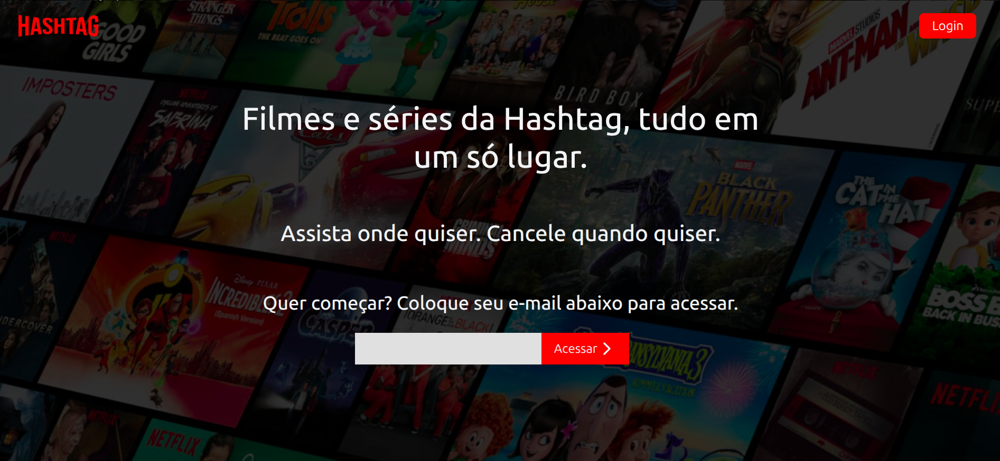
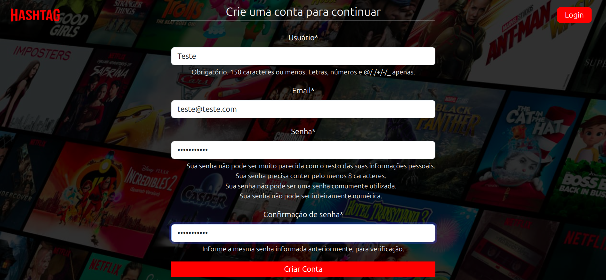
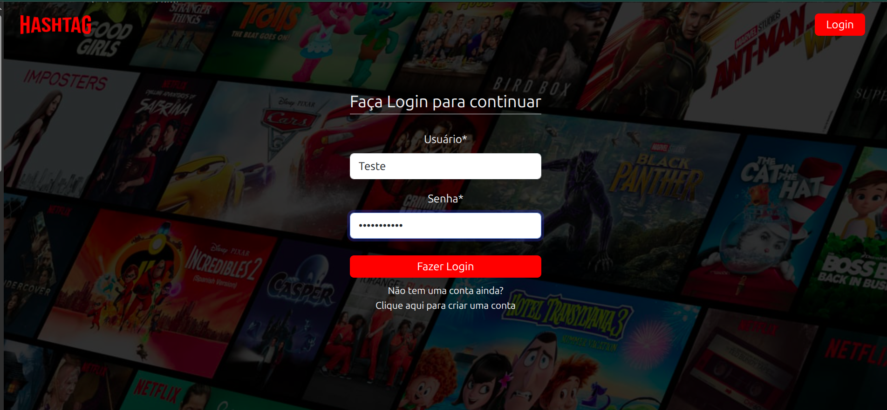
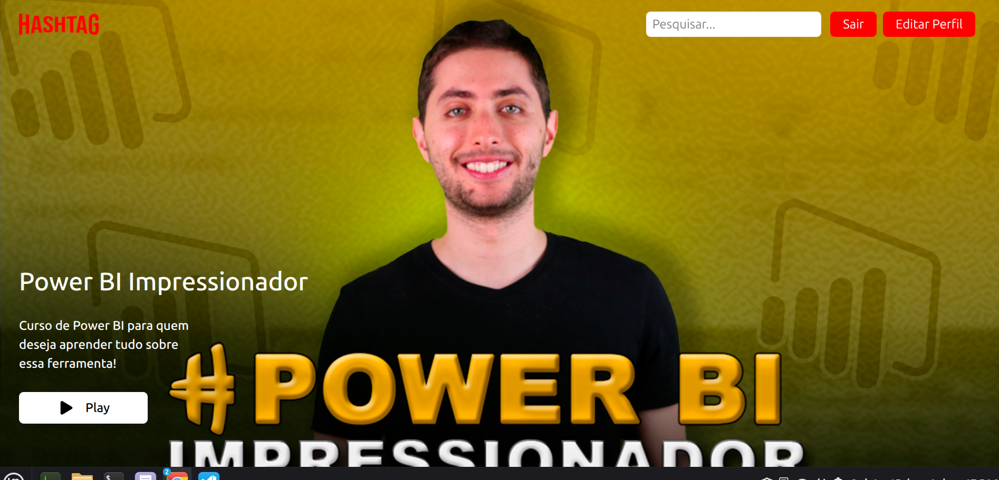
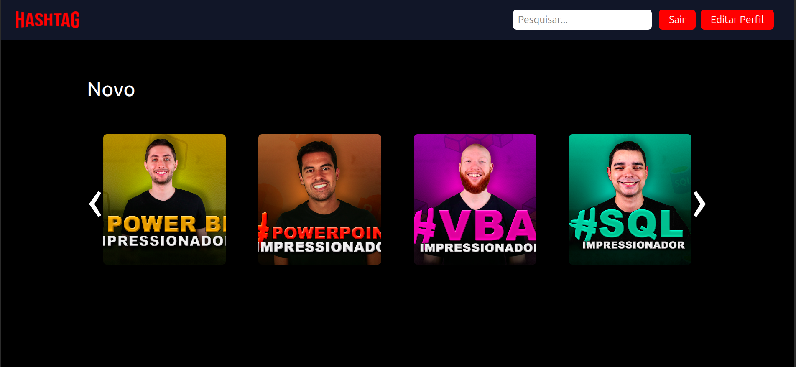
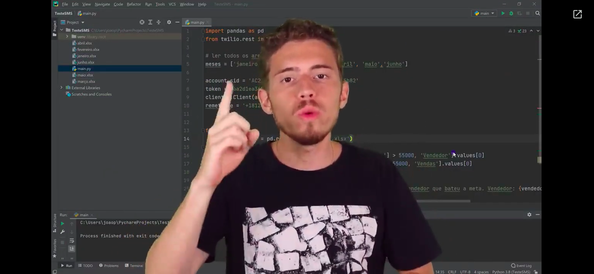
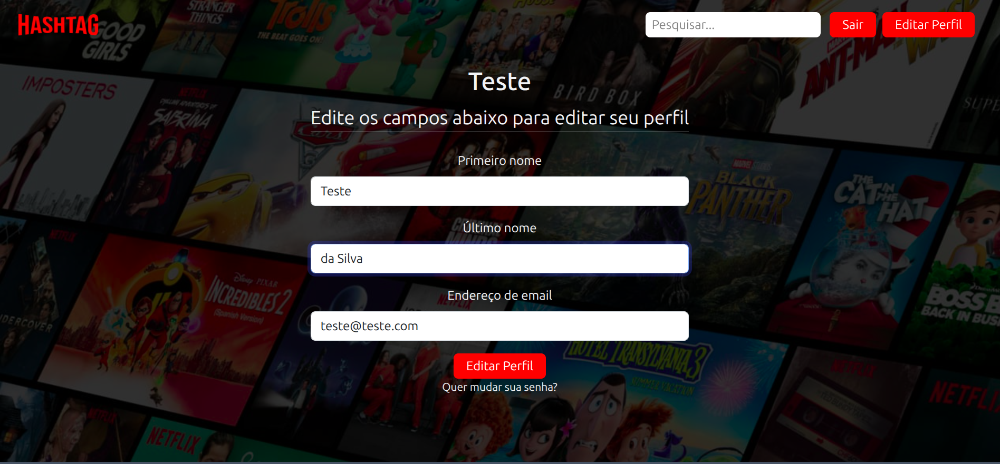

# Clone do Site da Netflix - Django

Clone do site de streaming Netflix, desenvolvido utilizando o framework Django.

---

## Demonstração

| Página Inicial | Página de Criação de Conta |
| :---: | :---: |
|  |  |

| Página de Login | Previsão de Filmes (pt1) |
| :---: | :---: |
|  |  |

| Página de Filmes (pt2) | Exemplo de Filme |
| :---: | :---: |
|  |  |

| Página de Edição de Perfil | 
| :---: |
|  |
---

## Tecnologias

Este projeto foi desenvolvido utilizando as seguintes tecnologias:

- **Python 3.12.3**
- **HTML5**
- **Django (Criação de páginas de internet)**
- **Django-CrispyForms (Estilização de formulários)**
- **Pillow (Manipulação de imagens)**

---

## Funcionalidades

- [x] Criação e autenticação de usuários
- [x] Página inicial de filmes, com filmes novos, mais assistidos e já assistidos
- [x] Página do filme/série, com episódios
- [x] Player de vídeo do Google Drive, onde estão armazenados os filmes de teste
- [x] Edição de perfil

---

## Estrutura de Dados

O projeto conta com um arquivo `db.sqlite3` contendo exemplos de usuários e para permitir o teste do site, bem como a criação e armazenamento de informações de novos usuários. As senhas são armazenadas após criptografia, tornando o banco de dados seguro. Todos os usuários foram criados usando e-mails fictícios.

---

## Como Executar o Projeto

### Pré-requisitos

Antes de começar, você precisará ter instalado em sua máquina:
- [Git](https://git-scm.com)
- [Python 3.12](https://www.python.org/)

### Passo a Passo

1. **Clone este repositório:**
   ```bash
   git clone https://github.com/Brazil25/hashflix
   ```

2. **Acesse a pasta do projeto:**
   ```bash
   cd hashflix
   ```

3. **Crie e ative o ambiente virtual (opcional, mas recomendado):**
   ```bash
   python -m venv .venv
   source venv/bin/activate  # Linux/Mac
   # ou: venv\Scripts\activate  # Windows
   ```

4. **Instale as dependências:**
   ```bash
   pip install -r requirements.txt
   ```

5. **Execute a aplicação:**
   ```bash
   python manage.py runserver
   ```

6. **Acesse o link:**
   - Acesse o link de desenvolvimento gerado pelo Django para ter acesso ao site e todas as suas funcionalidades.

---

## Licença

Este projeto está sob a licença MIT.
